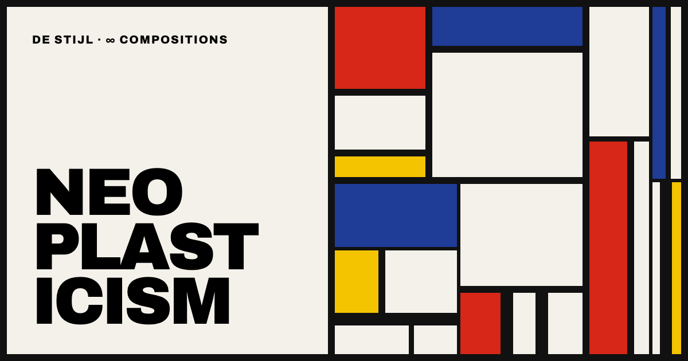

# Infinite Composition

An endless De Stijl canvas built with [Astro](https://astro.build). Scroll forever through generated Mondrian-style compositions. Click one to recompose it, open it full screen, save the ones you like, or download one as a wallpaper.

**Live:** https://dru-o7.github.io/infinite-composition/



## Run it

```sh
npm install
npm run dev      # http://localhost:4321
npm run build    # static site in dist/
npm test         # unit tests (vitest)
npm run og       # regenerate the social preview image (needs Google Chrome)
```

## Using it

- **Click** a work to recompose it. Its lines slide to new positions.
- **Tap** a work on a phone or tablet to open it full screen.
- **Hover** a work for buttons to open it, recompose it, save it, download a PNG or copy a link.
- **Viewer:** shows one work at a time, full screen. Swipe (or use ← →) to move between works, and tap the work to recompose it. From here you can also save the work, download it, copy its link or download it as a wallpaper.
- **Saved works:** the heart saves a work. The red ♥ button in the corner opens your saved works, and you can swipe through them in the viewer. They are kept in this browser's local storage.
- **Wallpapers:** in the viewer, download any work at this screen's size, Phone (1170×2532), Desktop (2560×1440) or Square (2048×2048). It is redrawn at that size, so it stays sharp. Classic compositions stretch to the new shape, and the late styles redraw their pattern to fit.
- **Keyboard:** in the feed, shortcuts act on the selected work, or else the one under the mouse, or else the first one on screen.

  | Key | Action |
  | --- | --- |
  | ← ↑ → ↓ | Select a work, then move between works |
  | R (or Enter / Space on a selected work) | Recompose |
  | O | Open in the viewer |
  | S | Save, or remove from saved |
  | D | Download a 2400px PNG |
  | L | Copy a link to this work |
  | Esc | Deselect |

  In the viewer: ← → move between works, R recompose, S save, D download, W wallpaper sizes, L copy link, Esc close.

- **Phones:** the grid collapses to 6 columns, and each row is packed so every line is filled edge to edge.
- **Counter:** the yellow box in the corner counts the works generated so far.
- **Word cells:** large words from the De Stijl vocabulary (Rhythm, Balance, Line…), labelled with their row number.

- **Share:** `?seed=123456` reproduces a whole feed, row for row. A work's link (`?seed=…&work=boogie-98765-1.50`) shows that work at the top of the page.

## How it works

| Piece | File |
| --- | --- |
| Seeded randomness (`mulberry32`), row seeds | `src/lib/rng.ts` |
| Classic compositions: subdivision, varied line weights, balance rules | `src/lib/classic.ts` |
| Late styles: Boogie-Woogie and Lozenge (canvas) | `src/lib/late.ts` |
| What goes in each row; mobile row packing | `src/lib/plan.ts` |
| Share link format | `src/lib/share.ts` |
| Saved-works list (pure; parse, toggle, cap) | `src/lib/saved.ts` |
| Wallpaper sizes | `src/lib/wallpaper.ts` |
| Infinite scroll, row recycling, keyboard, feed actions | `src/scripts/feed.ts` |
| Painting works on screen and to PNG; recompose animation | `src/scripts/paint.ts` |
| Full-screen viewer and Saved panel | `src/scripts/viewer.ts` |
| Saved-works store (localStorage, synced across tabs) | `src/scripts/saved.ts` |
| Social card source (screenshotted to `public/og.png`) | `src/pages/og-card.astro` |

- **Balance rules:** white dominates, primaries cover at most half a work, tiny planes never take a primary, and neighbouring planes never share a colour.
- **Line weights:** most works vary the weight of each line, as Mondrian did. Some keep one even weight.
- **Memory stays flat:** rows more than 4000px from the viewport are emptied and rebuilt exactly when you scroll back. Each row has its own seed, and recomposed works remember their new seed.
- **Late styles:** about one row in five holds a *Boogie-Woogie* or *Lozenge* work. Change `LATE_STYLE_CHANCE` in `plan.ts` to adjust.

Set `site` in `astro.config.mjs` once deployed, so the social preview uses an absolute image URL.
